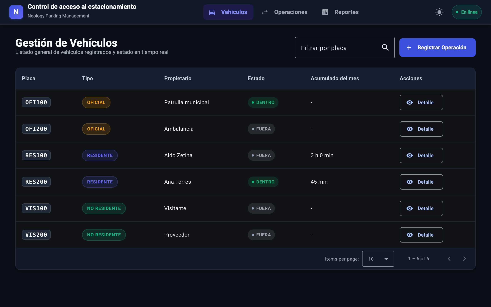
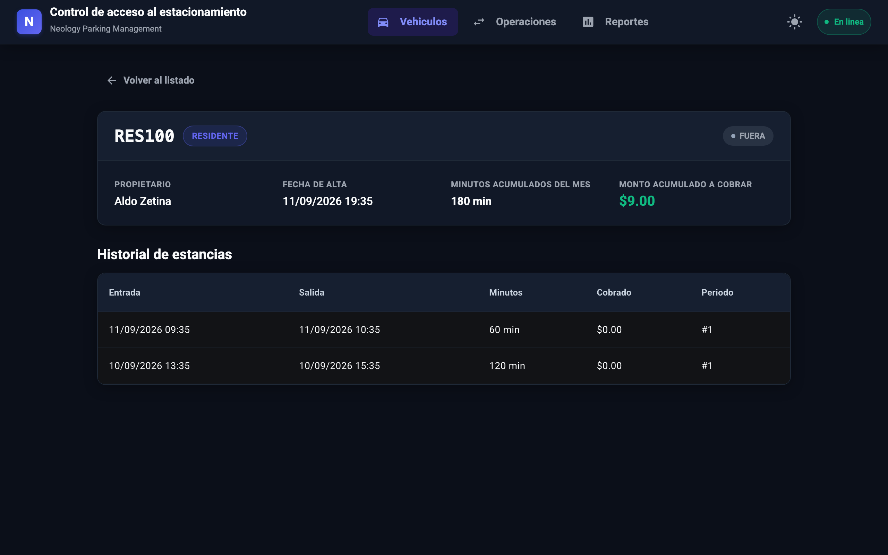
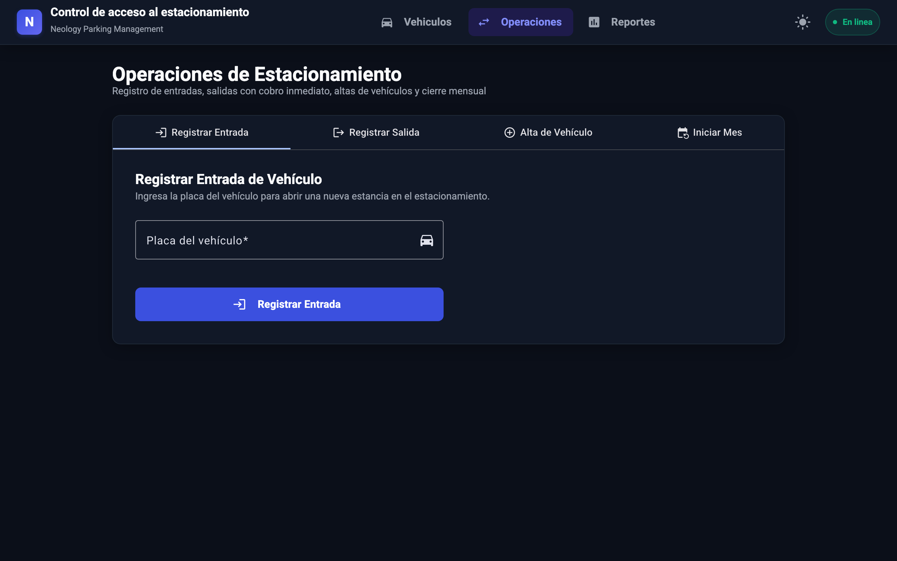
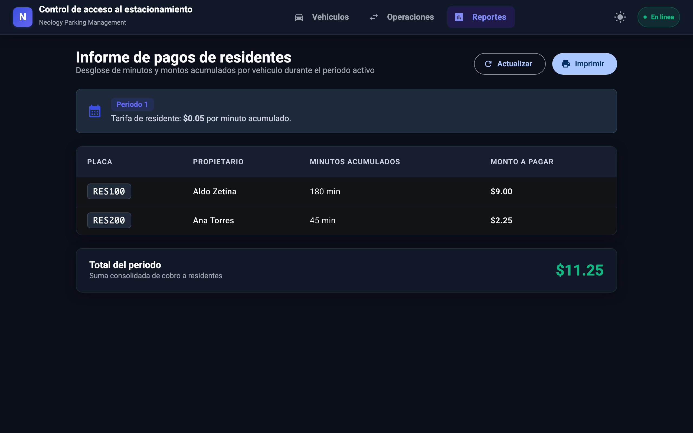
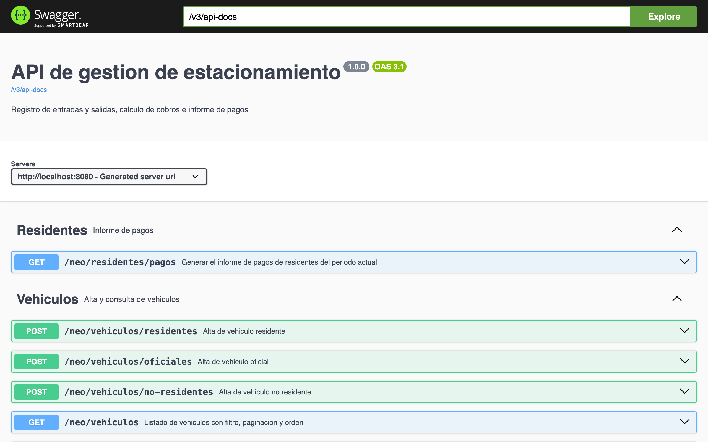

# Full-Stack-Prueba-tecnica-Neology

Instrucciones de la prueba tecnica 

La siguiente es una prueba para evaluar a los postulantes para un perfil de Full Stack.

## INTRODUCCIÓN
Este repositorio contiene una serie de requerimientos de un Caso Práctico, que busca evaluar las capacidades técnicas del candidato con respecto a las principales funciones y responsabilidades que se requieren dentro del área de Desarrollo de software de Neology.

## ¿Qué se busca evaluar?
Principalmente los siguientes aspectos:

* Creatividad para resolver los requerimientos.
* Uso de experiencia y conocimiento en base a buenas praticas.
* Eficiencia de los algoritmos entregados.
* Mostrar la experencía y la manera de poder salir de la caja para romper o identificar cualquier falla o mejora.
* Familiaridad con Frameworks y plataformas.


## Consideraciones al finalizar la prueba:
Enviar la prueba tecnica hacía el correo de la consultora y copiando la prueba al correo vmiranda@neology.mx y lluna@neopartners.mx.
Cumplir con los puntos que solicitan, hacer enfasis en el detalle de las interfaces.<br>
Clonar el proyecto y subirlo como una rama adicional.


## Instrucciones:
* Tiempo estimado: 5 horas
* Se espera que completes las tareas especificadas a continuación utilizando Angular & Spring Boot.
* La prueba se evaluará en función de la calidad del código, la organización, la atención al detalle y la precisión en la implementación de los requisitos.

## Objetivo General de la prueba Técnica:

Desarrollar un sistema web que permita gestionar el acceso de vehículos a un estacionamiento, con una interfaz frontend en Angular y una API backend en Spring Boot.<br>
El sistema debe registrar entradas y salidas, calcular cobros y mostrar reportes.


### Parte 1 – Backend (Spring Boot):
## Tecnologías:
* Java 17+
* Spring Boot 3.x
* Maven
* Hibernate + JPA
* Base de datos H2 (en memoria)
* Lombok (opcional)
* Swagger (opcional)


### 1. Endpoints requeridos:

* POST neo/vehiculos/oficiales: Alta de vehículo oficial
* POST neo/vehiculos/residentes: Alta de vehículo residente
* POST neo/vehiculos/no-residentes: Alta de vehículo no residente (opcional)
* POST neo/estancias/entrada: Registrar entrada de vehículo
* POST neo/estancias/salida: Registrar salida de vehículo
* GET neo/residentes/pagos: Generar informe de pagos
* POST neo/mes/iniciar: Reiniciar mes (reseteo de tiempos y estancias)

### 2. Modelos principales:

* Vehículo (placa, tipo)
* Estancia (placa, fecha/hora entrada, fecha/hora salida)
* Residente (placa, tiempo acumulado)

### 3. Reglas de negocio:

* Vehículos oficiales no pagan.
* Residentes pagan $0.05/minuto (acumulado).
* No residentes pagan $0.5/minuto al salir.
* El sistema debe permitir agregar fácilmente nuevos tipos de vehículos.

### 4. Pruebas unitarias:

* Crear pruebas mínimas para los servicios más importantes (ej: cálculo de cobro, registro de estancias).


## Parte 2 – Frontend (Angular):
### Tecnologías:
* Angular 16+
* Angular Material
* SCSS o CSS

### 1. Requerimientos funcionales:

* Página de listado de vehículos (consumir desde el backend).<br> 
Formulario para:
* Registrar entrada
* Registrar salida
* Dar de alta vehículo oficial o residente
* Iniciar nuevo mes

* Vista de detalle para cada vehículo (estancias, pagos acumulados si aplica).<br>
* Página de reporte de residentes (visualización de informe).

### 2. Extras recomendados:

* Filtro por placa en el listado.
* Paginación y ordenamiento.
* Validación de campos.
* Prevenir XSS en campos de entrada.
* Pruebas unitarias básicas con Jasmine + Karma.
* Utiliza Angular Material para mejorar el diseño y la experiencia del usuario.

## Entrega:

### Repositorio GitHub con:
* Proyecto Angular (frontend/)
* Proyecto Spring Boot (backend/)

### Instrucciones claras en el README para:
* Levantar backend y frontend
* Realizar pruebas
* Base de datos precargada opcionalmente
* Capturas de pantalla del frontend funcionando
* Código bien organizado, modular, con buenas prácticas


Nota:
No te preocupes si no puedes completar todos los requisitos en el tiempo asignado. Se valorará el progreso y la calidad del trabajo realizado.

---

# Solución

Sistema de gestión de acceso a un estacionamiento. Backend en Spring Boot y frontend en Angular.

## Requisitos

- Java 21 o superior
- Maven 3.9 o superior
- Node 20 o superior

## Levantar el backend

```bash
cd backend
./mvnw spring-boot:run
```

Queda disponible en `http://localhost:8080`.

- Documentación de la API: `http://localhost:8080/swagger-ui.html`
- Consola de la base en memoria: `http://localhost:8080/h2-console`
  - Cadena de conexión: `jdbc:h2:mem:estacionamiento`
  - Usuario: `sa`, sin contraseña

La base arranca precargada con seis vehículos de los tres tipos, dos estancias cerradas y dos vehículos dentro del estacionamiento.

## Levantar el frontend

```bash
cd frontend
npm install
npx ng serve
```

Queda disponible en `http://localhost:4200`. El cliente usa un proxy hacia el puerto 8080, así que ambos proyectos deben estar corriendo.

## Ejecutar las pruebas

Backend:

```bash
cd backend && ./mvnw test
```

Frontend:

```bash
cd frontend && npx ng test --watch=false --browsers=ChromeHeadless
```

## Endpoints

| Método | Ruta | Descripción |
|---|---|---|
| POST | `/neo/vehiculos/oficiales` | Alta de vehículo oficial |
| POST | `/neo/vehiculos/residentes` | Alta de vehículo residente |
| POST | `/neo/vehiculos/no-residentes` | Alta de vehículo no residente |
| POST | `/neo/estancias/entrada` | Registrar entrada |
| POST | `/neo/estancias/salida` | Registrar salida y cobrar |
| GET | `/neo/residentes/pagos` | Informe de pagos del periodo |
| POST | `/neo/mes/iniciar` | Reiniciar mes |
| GET | `/neo/vehiculos` | Listado con filtro, paginación y orden |
| GET | `/neo/vehiculos/{placa}` | Detalle con historial de estancias |

## Reglas de cobro

| Tipo | Cuándo paga | Tarifa por minuto |
|---|---|---|
| Oficial | Nunca | 0 |
| Residente | Al cerrar el mes, sobre minutos acumulados | 0.05 |
| No residente | Al registrar su salida | 0.50 |

Los minutos se redondean hacia arriba. Los montos usan decimal exacto con dos posiciones.

## Cómo agregar un tipo de vehículo nuevo

1. Agregar la constante al enum `TipoVehiculo`.
2. Crear una clase que implemente `Tarifa` y marcarla como componente de Spring.

Ningún archivo existente se modifica. Spring detecta la implementación nueva y el resolutor la indexa sola.

## Codigos de respuesta

| Situacion | Codigo HTTP | Codigo en el cuerpo |
|---|---|---|
| Alta correcta de vehiculo o entrada registrada | 201 | |
| Consulta o salida correcta | 200 | |
| Datos mal formados, placa fuera de rango, campo de orden invalido | 400 | `SOLICITUD_INVALIDA` |
| Placa no registrada o ruta inexistente | 404 | `NO_ENCONTRADO` |
| Metodo HTTP no soportado por la ruta | 405 | `METODO_NO_PERMITIDO` |
| Placa duplicada, entrada repetida, salida sin entrada previa | 409 | `REGLA_DE_NEGOCIO` |
| Fallo no previsto | 500 | `ERROR_INTERNO` |

Todos los errores comparten el mismo cuerpo, con codigo, mensaje y momento. Nunca se expone una traza de excepcion.

La placa se valida en tres puntos: el formulario, el objeto de entrada de la API y la normalizacion del servicio. Se admiten entre 5 y 10 letras o numeros, sin contar espacios ni guiones, que se eliminan al guardar.

## Capturas








