# Parking Lot

Sistema de gestión de estacionamiento con backend en Spring Boot (Java) y frontend en Angular. Permite registrar la entrada de vehículos en lugares (spots), consultar su detalle, calcular el cobro según el tipo de vehículo y registrar la salida con su pago.

## Stack tecnológico

- **Java 21**
- **Spring boot 4**
- **Hibernate, Spring JPA**
- **Angular 21, tailwind, angular material**
- **Node v22**

## Requisitos previos

- **Java 21** y Maven (se usa el wrapper `./mvnw`, no necesitas instalar Maven aparte).
- **Node.js** y **Angular CLI** para el frontend.
- La base de datos es **H2 en memoria**, por lo que no requiere instalación ni configuración externa: se crea al arrancar el backend y se borra al detenerlo.

## Primer paso: clonar y cambiar de rama

Después de clonar el repositorio de GitHub, cámbiate a la rama de trabajo antes de hacer cualquier otra cosa:

```bash
git checkout feature/fullstack-parking-lot
```

Todo el código del proyecto (backend y frontend) vive en esta rama.

## Despliegue del backend

Desde la carpeta del backend, ejecuta:

```bash
./mvnw clean spring-boot:run
```

Esto compila y levanta la aplicación en `http://localhost:8080`.

### URLs útiles del backend

Una vez arrancado, quedan disponibles:

- **Consola H2** (para inspeccionar la base de datos en memoria): `http://localhost:8080/h2-console`
- **Documentación de la API (Swagger UI)**: `http://localhost:8080/swagger-ui/index.html#/`

### Acceso a la consola H2

En la consola H2, inicia sesión con estas credenciales:

- **URL JDBC**: `jdbc:h2:mem:parkinglotdb`
- **Usuario**: `sa`
- **Contraseña**: `password`

Recuerda que al ser una base de datos en memoria, los datos existen solo mientras el backend está corriendo; al detenerlo se pierden.

## Endpoints

Vehículo.
* POST neo/vehicles/official: Alta de vehículo oficial
* POST neo/vehicles/resident: Alta de vehículo residente
* POST neo/vehicles/no-resident: Alta de vehículo no residente
* GET neo/vehicles: Listado de vehículos
* GET neo/vehicles/{plate}/detail: Detalle de vehículo

Estancia.
* POST neo/stays/entry: Registrar entrada de vehículo
* POST neo/stays/exit/{license}: Registrar salida de vehículo

Cajon de estacionamiento.
* POST neo/spots: Alta de cajon de estacionamiento
* GET neo/spots: Listado de cajones de estacionamiento
* GET neo/spots/{id}/status: Actualizar estatus de cajon de estacionamiento Disponible-Ocupado, Ocupado-Disponible

Pagos.
* POST neo/payments: Registrar un pago
* GET neo/payments: Listado de pagos

## Despliegue del frontend

Desde la carpeta del frontend, instala dependencias la primera vez y luego arranca el servidor de desarrollo:

```bash
npm install
ng serve -o
```

La bandera `-o` abre el navegador automáticamente. La aplicación queda disponible en `http://localhost:4200`.

> El frontend consume el backend en `http://localhost:8080`, así que el backend debe estar corriendo para que la aplicación funcione.

## Datos iniciales (seed) y botón "Insertar spots"

Un "spot" es un cajon de estacionamiento con un ID único, está prueba técnica simula los lugares disponibles.

Como la base de datos es **en memoria**, cada vez que se reinicia el backend la tabla de spots (`t_spots`) queda vacía. Para no tener que crear los lugares a mano, el frontend incluye un mecanismo de carga inicial.

### El archivo de seed

En el frontend existe un archivo de datos (`spots.data.json`) que define el catálogo fijo de lugares del estacionamiento, del **A-01 al B-08** (16 spots en total). Este archivo es la fuente de la carga inicial: describe qué lugares existen en el layout.

### El botón "Insertar spots"

En la pantalla principal (Parking Lot) hay un botón **Insertar spots**. Al presionarlo:

1. Lee el catálogo de lugares desde el archivo de seed.
2. Envía cada lugar al backend mediante peticiones `POST /spots`, insertándolos todos como **disponibles** (`available`).
3. Al terminar, recarga la cuadrícula para mostrar los lugares ya creados.

Comportamiento importante:

- El botón se **deshabilita automáticamente** cuando ya existen spots cargados, para evitar insertarlos dos veces (la placa/código de cada spot es único, por lo que una segunda inserción provocaría un conflicto en el backend).
- Si reinicias el backend, la tabla vuelve a quedar vacía y el botón se habilita de nuevo para volver a sembrar los datos.

### Flujo recomendado al iniciar

1. Clona el repositorio y cámbiate a la rama `feature/fullstack-parking-lot`.
2. Arranca el backend (`./mvnw clean spring-boot:run`).
3. Arranca el frontend (`ng serve -o`).
4. En la pantalla Parking Lot, presiona **Insertar spots** una vez.
5. La cuadrícula se llena con los 16 lugares disponibles y el sistema queda listo para registrar entradas y salidas de vehículos.

## Evidencias

Página principal (fronted)
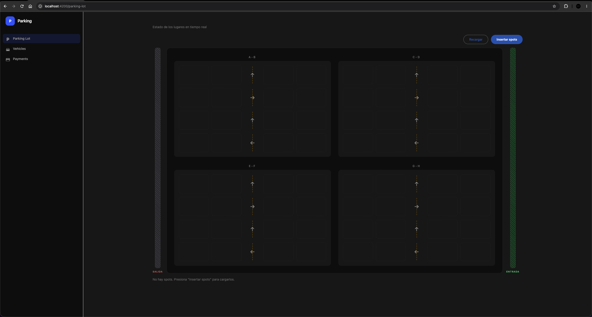

Para comenzar con la prueba técnica "click" en el botón insertar spots, esta acción va a cargar los lugares de estacionamiento.
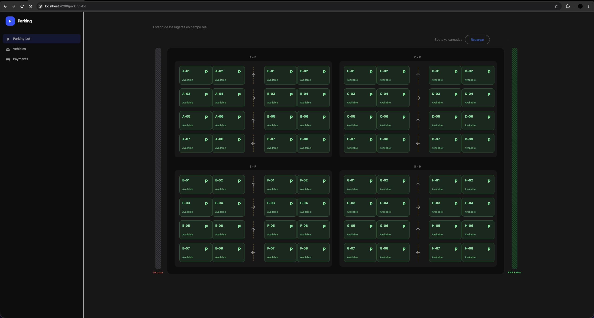
Base de datos:
Listado de Cajones de estacionamiento (Spot).
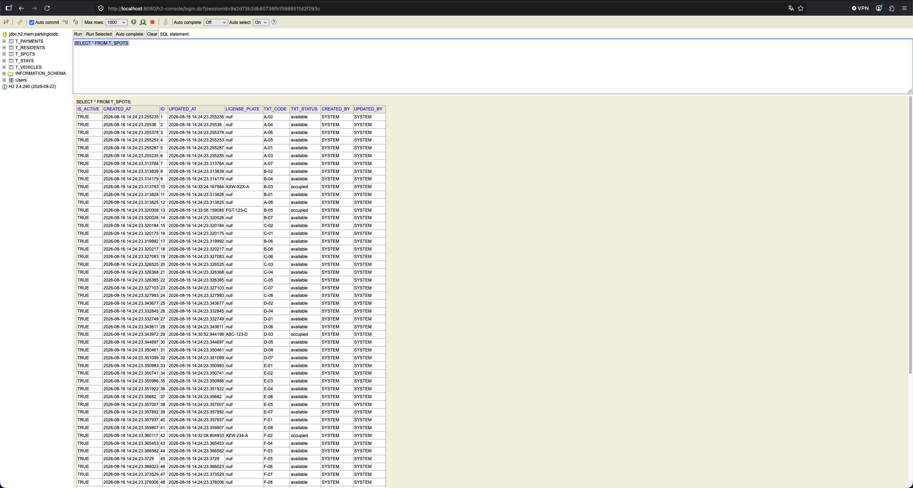

El caso de uso que resuelve esta funcionalidad:

Imaginemos que tenemos una persona que quiere registrar un vehículo en el estacionamiento con la herramienta "parking-lot", este actor tendrá la posibilidad de ver todos los lugares del estacionamiento disponibles. Cuando llegue un vehículo y escoja un "cajon de estacionamiento" el actor dará click en el botón verde igual al que el dueño del vehiculo escogio para estacionar su auto, y regitrará los datos del vehículo en dicho "cajon de estacionamiento", y su hora de llegada.
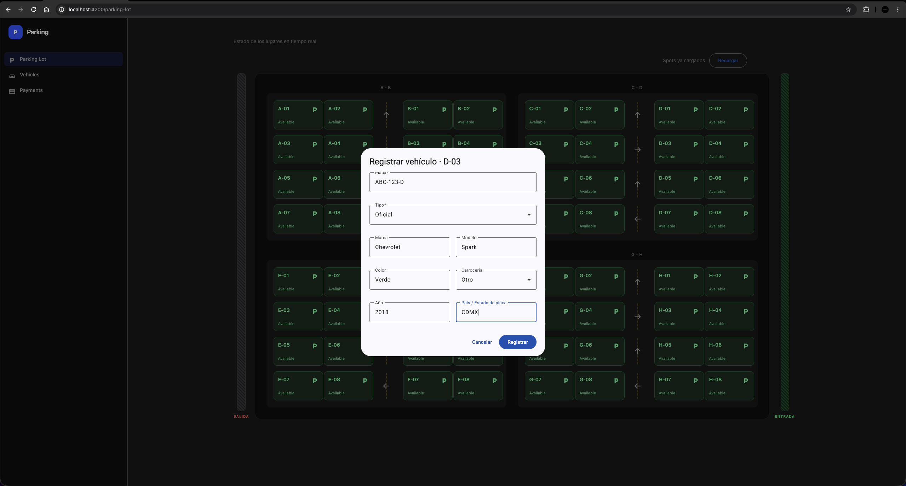

Después de insertar un vehículo, el "cajon de estacionamiento" aparecerá como ocupado
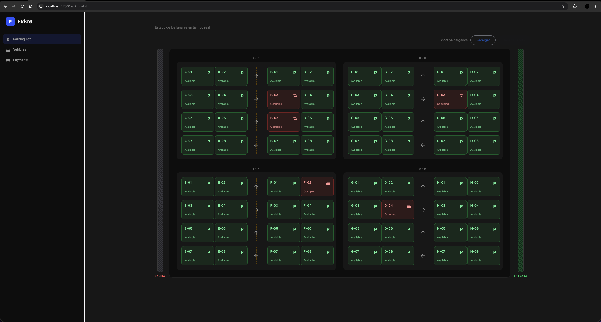
Base de datos:
Listado de Vehiculos.
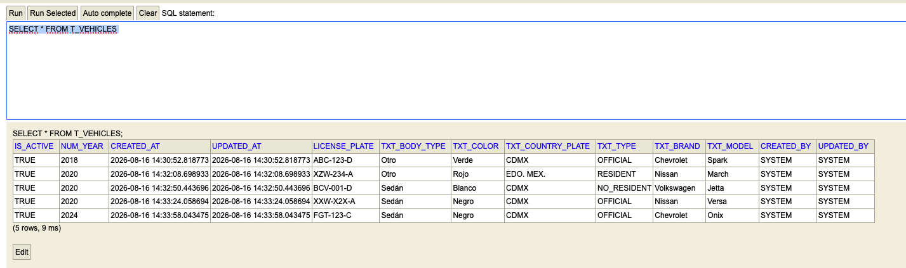
Listado de estancias.
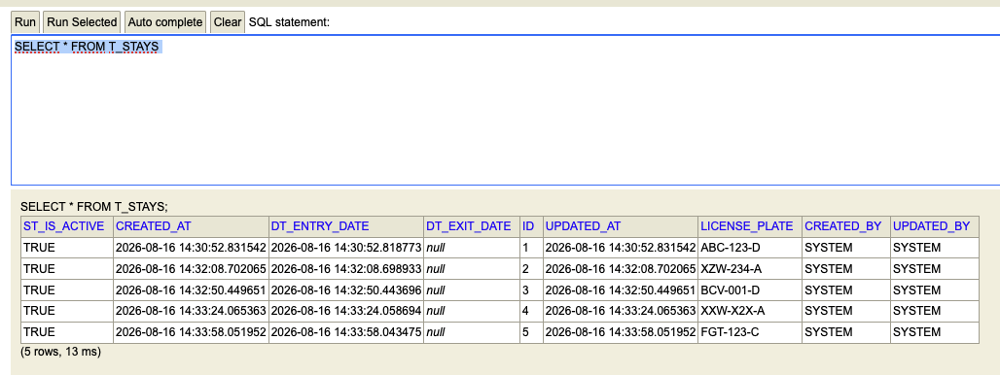

Cuando demos click al "cajon de estacionamiento" podremos ver el detalle del vehiculo que se estaciono ahí, junto con el tiempo acumulado y el total.
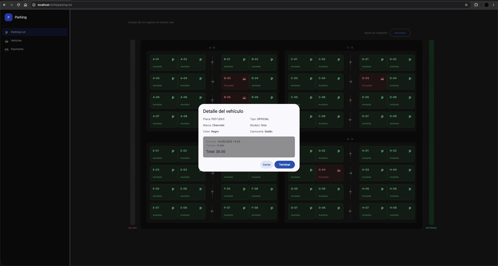

Si damos "click" en el boton terminar, se registrara la fecha de salida de la estancia, y se creará un registro en la BD con los datos del pago. Y el "cajon de estacionamiento" pasará de un estatus ocupado a disponible.
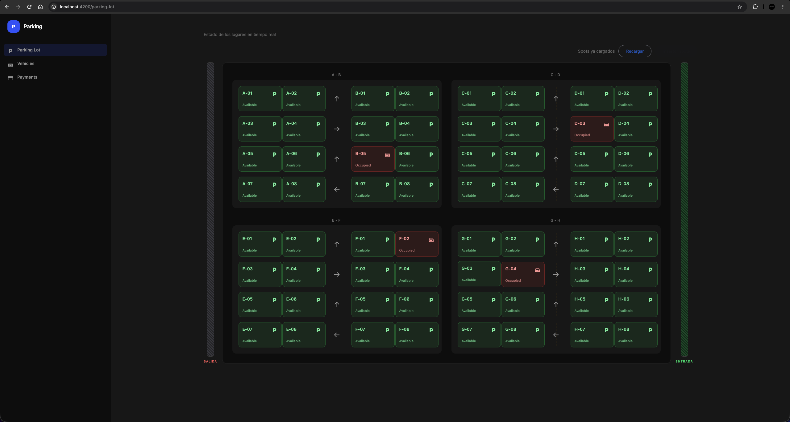
Base de datos:
Listado de pagos.
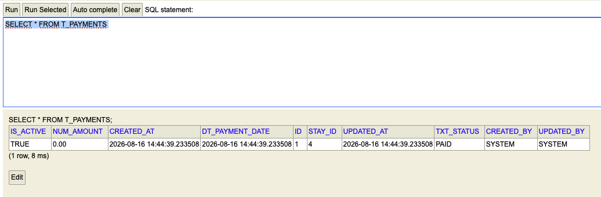

/vehicles
Listado de vehiculos registrados en la BD.
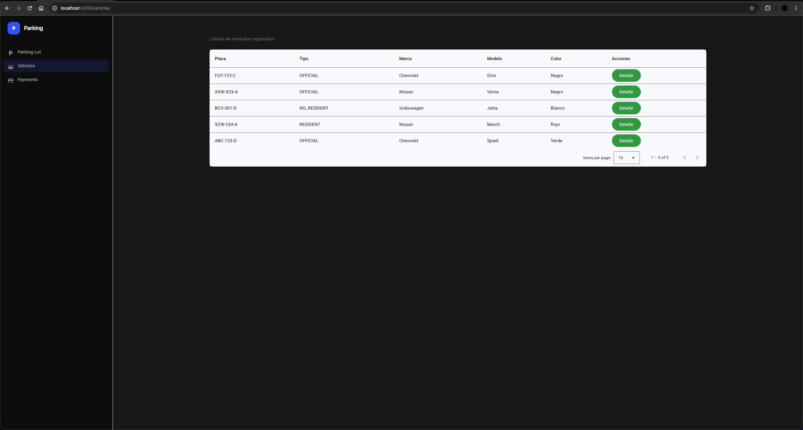

/vehicles
Detalle del vehículo
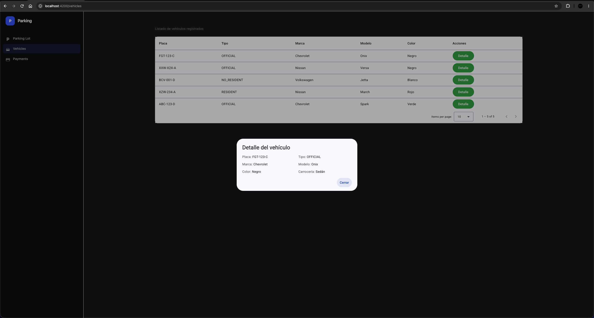

Listado de endpoints.
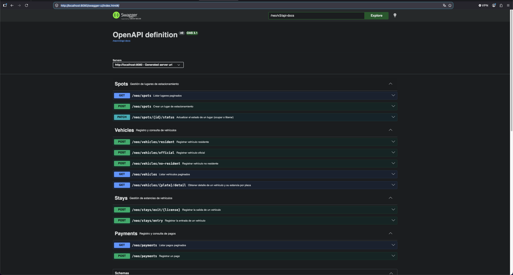


