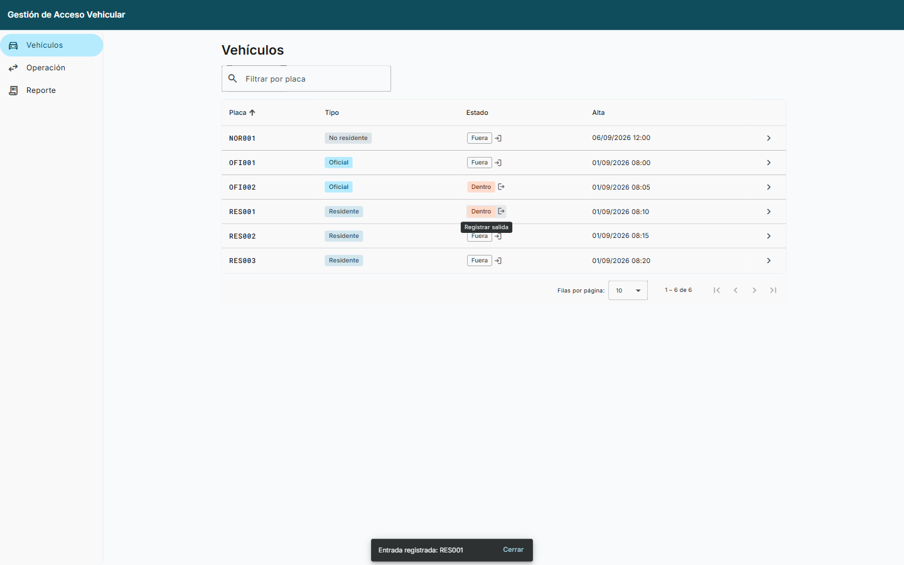

# Gestión de Acceso Vehicular

Sistema web para gestionar el acceso de vehículos a un estacionamiento: registra entradas y salidas,
calcula cobros por tipo de vehículo y genera el informe mensual de pagos de residentes.

Prueba técnica Full Stack para Neology. El enunciado original está en
[Requerimientos.md](Requerimientos.md); las decisiones de diseño en [docs/decisiones.md](docs/decisiones.md).

| Capa | Tecnología |
|------|------------|
| Backend | Java 21 · Spring Boot 4.1.1 · Spring Data JPA / Hibernate · H2 en memoria · Flyway · springdoc-openapi · Apache POI · Maven Wrapper |
| Frontend | Angular 22 · Angular Material (M3, tema propio) · SCSS · Formularios reactivos · Jasmine + Karma |
| Calidad | JUnit 5 + Mockito + AssertJ · JaCoCo · Spotless (google-java-format) · Prettier · GitHub Actions |

## Requisitos previos

- **Java 21** (`java -version`)
- **Node.js 24** y npm (`node -v`)
- Google Chrome (solo para ejecutar las pruebas del frontend)

No hace falta instalar Maven ni Angular CLI: se usan `./mvnw` y los scripts de `npm`.

## Cómo levantar

### Backend

```bash
cd backend
./mvnw spring-boot:run          # Windows (cmd/PowerShell): mvnw.cmd spring-boot:run
```

- API: <http://localhost:8080/neo/...>
- Swagger UI: <http://localhost:8080/swagger-ui.html> · OpenAPI: <http://localhost:8080/v3/api-docs>
- Salud: <http://localhost:8080/actuator/health>

La base de datos H2 se crea en memoria al arrancar; Flyway aplica el esquema (`V1__esquema.sql`) y los
datos de ejemplo (`V2__datos_iniciales.sql`). Al detener el backend los datos se pierden.

### Frontend

```bash
cd frontend
npm ci
npm start                       # ng serve con proxy: /neo y /actuator → http://localhost:8080
```

Abrir <http://localhost:4200>. Páginas: **Vehículos** (listado con filtro, paginación y ordenamiento;
el chip de estado registra la entrada o la salida con un clic; detalle por placa), **Operación**
(entrada, salida, alta de vehículo con entrada inmediata opcional, iniciar mes) y **Reporte**
(informe de pagos de residentes con descarga en Excel).

## Cómo ejecutar las pruebas

```bash
# Backend: pruebas unitarias e integración + cobertura JaCoCo + formato
cd backend && ./mvnw verify
# Informe de cobertura: backend/target/site/jacoco/index.html

# Frontend: Jasmine + Karma en Chrome headless, formato y build
cd frontend && npm run test:ci && npm run format:check && npm run build
```

El workflow [`.github/workflows/ci.yml`](.github/workflows/ci.yml) ejecuta exactamente estos comandos en
cada push.

## Base de datos precargada

`V2__datos_iniciales.sql` deja un periodo (mes) activo y estos vehículos:

| Placa | Tipo |
|-------|------|
| `OFI001`, `OFI002` | Oficial |
| `RES001`, `RES002`, `RES003` | Residente |
| `NOR001` | No residente |

Incluye estancias cerradas en el periodo actual (con su acumulado para los residentes) y una estancia
abierta, de modo que el listado, el detalle y el reporte muestran datos desde el primer arranque.

## API

| Método | Ruta | Descripción |
|--------|------|-------------|
| POST | `/neo/vehiculos/oficiales` | Alta de vehículo oficial `{ "placa": "ABC123" }` |
| POST | `/neo/vehiculos/residentes` | Alta de vehículo residente |
| POST | `/neo/vehiculos/no-residentes` | Alta de vehículo no residente (opcional) |
| POST | `/neo/estancias/entrada` | Registrar entrada `{ "placa": "ABC123" }` |
| POST | `/neo/estancias/salida` | Registrar salida; devuelve minutos e importe |
| GET | `/neo/residentes/pagos` | Informe de pagos del periodo activo. `Accept: application/json` → JSON; `Accept: application/vnd.openxmlformats-officedocument.spreadsheetml.sheet` → `.xlsx` |
| POST | `/neo/mes/iniciar` | Cierra el periodo activo y abre uno nuevo |
| GET | `/neo/vehiculos?placa=&page=&size=&sort=` | Listado paginado con filtro y ordenamiento |
| GET | `/neo/vehiculos/{placa}` | Detalle: tipo, estado, acumulado del periodo |
| GET | `/neo/vehiculos/{placa}/estancias` | Estancias del vehículo, paginadas |

Los errores siguen RFC 7807 (`application/problem+json`) con un campo `code`
(`VALIDACION`, `VEHICULO_YA_REGISTRADO`, `VEHICULO_YA_DENTRO`, `VEHICULO_NO_DENTRO`,
`VEHICULO_NO_ENCONTRADO`, `PARAMETRO_INVALIDO`).

## Reglas de negocio

| Tipo | Tarifa | Cuándo se cobra |
|------|--------|-----------------|
| Oficial | No paga | — |
| Residente | $0.05 / minuto | Acumulado por periodo; se liquida con el informe |
| No residente | $0.50 / minuto | Al registrar la salida |

- Se cobran minutos completos; los segundos sobrantes se descartan. Importes con dos decimales.
- Una placa desconocida que registra entrada se da de alta como no residente; puede reclasificarse después.
- Iniciar mes cierra el periodo activo y abre otro: las estancias quedan archivadas en su periodo y los
  acumulados de residentes vuelven a cero. Las estancias abiertas cuentan en el periodo en que salen.
- Las tarifas viven en `application.yml`; cada tipo de vehículo tiene su propia estrategia de cobro,
  por lo que agregar un tipo nuevo no toca los servicios existentes.

## Estructura

```
backend/   Spring Boot — mx.neology.acceso.{domain, application, infrastructure, web}
frontend/  Angular — src/app/{core, shared, features/{vehiculos, operacion, reporte}}
docs/      decisiones.md, PR.md, capturas/
blueprints/, .specify/, CLAUDE.md   Metodología: blueprint de arquitectura y Spec Kit
```

## Capturas

| Pantalla | Captura |
|----------|---------|
| Listado de vehículos (filtro, paginación, orden, entrada/salida con un clic) | [01-listado-vehiculos.png](docs/capturas/01-listado-vehiculos.png) |
| Detalle de vehículo con acumulado y estancias | [02-detalle-vehiculo.png](docs/capturas/02-detalle-vehiculo.png) |
| Operación: alta con entrada inmediata | [03-operacion-entrada.png](docs/capturas/03-operacion-entrada.png) |
| Operación: registrar salida con cobro | [04-registrar-salida.png](docs/capturas/04-registrar-salida.png) |
| Iniciar nuevo mes (confirmación) | [05-iniciar-mes-confirmacion.png](docs/capturas/05-iniciar-mes-confirmacion.png) |
| Reporte de residentes con descarga en Excel | [06-reporte-residentes.png](docs/capturas/06-reporte-residentes.png) |
| Manejo de errores RFC 7807 (salida sin entrada) | [07-error-salida-sin-entrada.png](docs/capturas/07-error-salida-sin-entrada.png) |



## Mejoras futuras

Autenticación y roles (Spring Security + JWT), bitácora de auditoría, base de datos persistente,
Docker Compose, tema oscuro y pruebas E2E con Playwright. Se dejaron fuera a propósito por el alcance
de la prueba; ver [docs/decisiones.md](docs/decisiones.md).
